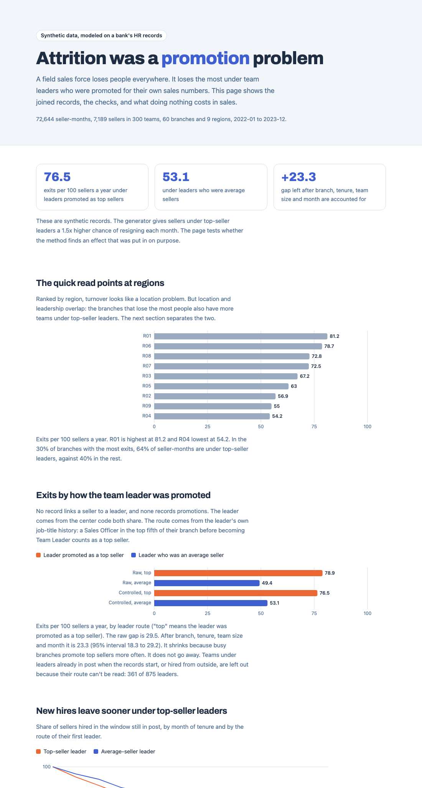

# Attrition was a promotion problem

Why does a field sales force keep losing people after hiring gets better? At a bank in Indonesia I found the answer in how team leaders were picked. Top sellers were promoted for their sales numbers alone, and their teams left faster. This repo rebuilds that evidence on synthetic records modeled on the layout of the bank's HR files: the join, the checks, and the cost in sales. The team leader effect in these records is a setting in the generator, so the repo shows the method, not the bank's numbers.



[Open the live dashboard](https://lorisca-analytics.github.io/sales-attrition-evidence-layer/)

## Summary

The field sales team had the highest turnover in the department, in a sales force where turnover was high everywhere. Leadership saw a hiring problem. I fixed hiring first, and people kept leaving. So I joined intake, exit interview, performance and training records that sat with different teams, and looked at exits by team leader and that leader's own sales history. Teams under leaders promoted as top sellers lost people faster than teams under leaders who had been average sellers with good people skills. I tightened hiring criteria, and Training reworked how team leaders were assessed for promotion and how they were trained. I cut department turnover about 15% (2023) and 17% (2024).

The real records hold personal data, so they stay private. Everything in this repo is generated by `ael/generate.py`.

## Problem

Turnover in field sales costs sales twice. A seat sits empty, then a new hire takes months to reach full output. Senior leadership had built the promotion rule, and their first answer to any fix was to protect the sales numbers.

Three things made the cause hard to see:

- No record says who reports to whom. Seller and team leader rows in the sales tracker each carry a center code, and that is the only link.
- No record says who was promoted, or why. A promotion shows up only as a job title that changes from one month's roster to the next.
- The exit form doesn't name the leader. Not every leaver fills it in, and "Leadership" is one choice among four.

## Inputs

Five synthetic files in `data/synthetic/`, modeled on the layout of the bank's roster, warning-letter, probation, resignation and exit form files. Training records aren't rebuilt here.

| File | Rows | What it holds |
|---|---|---|
| `roster_monthly` | 163,006 | Everyone on payroll each month: job title, center, branch, region, join date |
| `kpi_monthly` | 163,006 | Monthly KPI achievement, rating and warning stage (a shortened version of the bank's ladder: PIP1, PIP2, then warning letters SP1 to SP3) |
| `probation` | 6,648 | Probation result for each new hire |
| `resignations` | 8,553 | The exit list as HR filed it, with the date each row was recorded |
| `exit_interviews` | 3,440 | Exit form: reason (personal growth, career path, unsupportive scope of work, leadership) and whether they would return |

The analysis window is 2022-01 to 2023-12: 72,644 seller-months, 7,189 sellers, 300 teams, 60 branches, 9 regions. The dates are placeholders. `DATA_CONTRACT.md` sets the shape of every file, and `python -m ael.contract` refuses a broken one.

## Discovery

- **The region ranking points the wrong way.** R01 loses 81.2 sellers per 100 a year and R04 loses 54.2. That reads like a location problem. But location and leadership overlap: in the 30% of branches with the most exits, 64% of seller-months are under top-seller leaders, against 40% in the rest.
- **The raw gap overstates.** Teams under top-seller leaders lose 78.9 per 100 a year, against 49.4 under average-seller leaders. Part of that 29.5 gap is the branch, not the leader.
- **The exit form points away from leaders.** 1,262 forms match 2,804 resignations, and "Leadership" is 12% of them. Personal growth tops the list under both kinds of leader.
- **One region's exit list runs late.** In R07's last month, 20 people left the roster and none had a resignation row yet. Counted from the list, that month looks like everyone stayed.
- **Dead end.** My first no-effect check ran once and found a gap of 4.7 with an interval of 0.4 to 8.9. One run can miss by chance, so I made it twenty (Execution, point 5).

## Execution

1. **Link sellers to leaders by center code.** In each month, a seller's leader is the Team Leader on the same center.
2. **Read the promotion route from the roster.** A leader who was a Sales Officer in the top fifth of their branch over the 6 months before the title change counts as a top seller. Leaders with no seller history in the files are left out: 361 of 875.
3. **Count exits from the roster.** Someone missing from next month's roster left this month. The resignation list supplies the exit type and a check. A region-month where a quarter or more of the exits have no resignation row is held out.
4. **Hold the other causes still.** A logistic model on seller-months with branch, tenure, team size and month, standard errors clustered by team. KPI stays out of the model because a poor leader can drag KPI down before people quit.
5. **Check the method on data with no effect.** `scripts/null_calibration.py` generates 20 datasets with the leader effect switched off. The average gap is -0.4, and 18 of 20 intervals include zero, with one miss on each side.

Every choice, with the options I turned down, is in `DECISIONS.md`.

## Results

| | Top-seller leader | Average-seller leader | Gap |
|---|---|---|---|
| Raw, exits per 100 a year | 78.9 | 49.4 | 29.5 |
| After branch, tenure, team size, month | 76.5 | 53.1 | 23.3 (95% interval 18.3 to 29.2) |

The gap shrinks when branch comes in and stays clearly above zero. It holds for resignations alone (23.2), without each seller's first 3 months (21.4), and with top seller defined as the top 30% (23.3). After 12 months, 40% of new hires under top-seller leaders are still in post, against 52% under average-seller leaders.

In sales terms, the controlled gap is about 331 extra exits a year. Counting each exit as 1 empty month plus 3 months at half output, that is about 69 sellers' full-year sales lost every year. The three cost assumptions sit in `ael/analyze.py`.

What changed at the bank was a split by expertise. I tightened recruiting criteria, and Training reworked manager training, curriculum and promotion assessment, including the assessment used to promote sellers to team leader. My first pitch stalled because leadership had built the promotion rule and read the data as an attack on it. It moved once the fix read as a growth program they could own, framed in their language as protecting the sales pipeline. The cost-in-sales view on the dashboard is what I would put in front of them first today.

**Limits.** The effect is planted, so these numbers say nothing about the real bank. Leaders already in post when the records start can't be classified. The model controls for what the files hold, and a real dataset would have causes these files don't.

## How to run

```bash
python -m venv .venv && source .venv/bin/activate
pip install -r requirements.txt
python -m ael.generate                # writes data/synthetic, same files every time
python -m ael.contract data/synthetic # checks them against the contract
python -m ael.analyze                 # joined view, results, dashboard data (about a minute)
python -m pytest -q
python -m http.server 8000 --directory dashboard
```

`notebooks/walkthrough.ipynb` runs the same steps one at a time with a note on each. `python scripts/null_calibration.py` reruns the no-effect check (about 10 minutes). `python -m ael.generate --leader-effect 1.0` writes a dataset with no effect to try the method on.

## Repo map

| Path | What |
|---|---|
| `ael/generate.py` | Synthetic records, every assumption in `PARAMS` |
| `ael/contract.py`, `contract/` | Data contract and checker |
| `ael/view.py` | The joined seller-month view |
| `ael/analyze.py` | Rates, model, survival, exit reasons, cost, sensitivity |
| `scripts/null_calibration.py` | The method run on 20 no-effect datasets |
| `notebooks/walkthrough.ipynb` | Step-by-step walkthrough |
| `dashboard/` | Plain HTML page, data as CSV and JSON |
| `tests/` | Contract, generator and join-rule tests |
| `DECISIONS.md` | Choices, options turned down, costs |

All data is synthetic. Code: MIT license.
